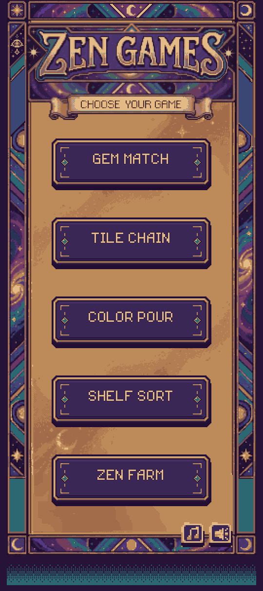
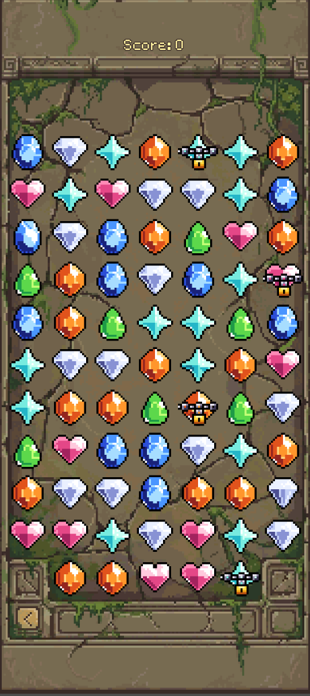
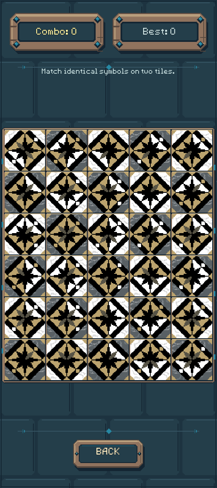
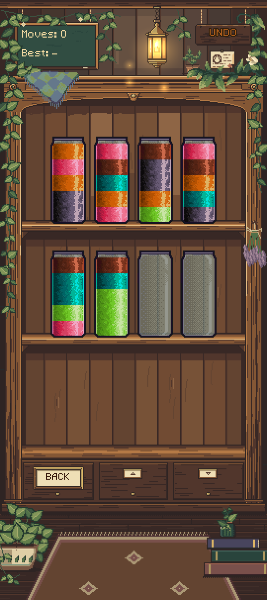
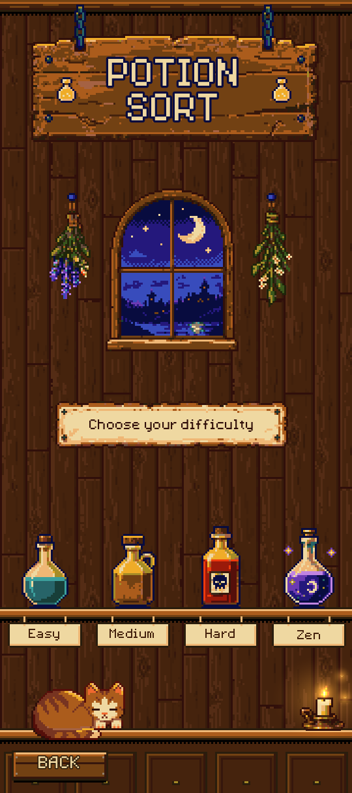
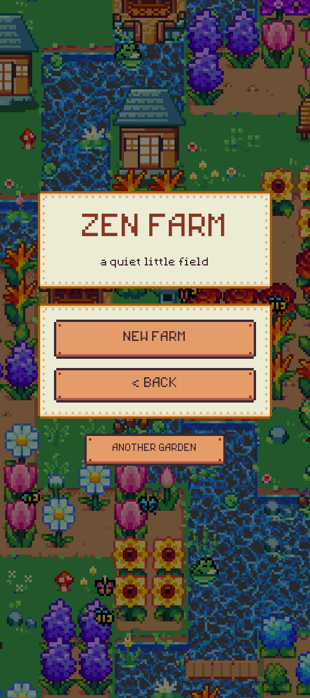

# Zen Games

**Zen Games** is a collection of small puzzle and garden games built with
Godot 4.3, primarily for Android. Web support is incoming.

There are no timers. No energy systems. Just tap-tap, clink-clink and some music. Gem Match also offers
**optional timed and level modes**; Zen Farm uses growth and weather cycles. All vibes.

## Screenshots

Captured 20 October 2026 from the current scenes. Potion Sort and Zen Farm show
their menus. The gallery excludes Potion Sort's third-party item images.

<table>
  <tr>
    <td align="center"> Hub</td>
    <td align="center"> Gem Match</td>
    <td align="center"> Tile Chain</td>
  </tr>
  <tr>
    <td align="center"> Alchemical Sort</td>
    <td align="center"> Potion Sort menu</td>
    <td align="center"> Zen Farm menu</td>
  </tr>
</table>

## Current games

All five core loops are playable. The collection is still in development:
presentation, sound, instructions, puzzle generation, progression, phone
validation and release setup all have work remaining.

| Game | Implemented |
| --- | --- |
| **Gem Match** | Match-3 cascades, upgrading gems (topped by star, heart and sun), special gems with pixel-art fire, lightning and moon effects, locked gems, hints, automatic shuffling, an untimed mode, optional timed/level modes and their saved records. |
| **Tile Chain** | Layered-symbol pairing, combo chains, three randomly selected tilesets, selection/removal effects, reshuffling and a saved best combo. |
| **Alchemical Sort** | Bottle color sorting, Easy/Medium/Hard/Zen layouts, mystery rounds, undo, move records, catalyst/helper mechanics, cabinet art and interactive lamps. |
| **Potion Sort** | Triple-match shelf sorting, hidden layers, undo, conveyors, dispensers, locks, mystery items, move records and an interactive shop with candle, window, owl and cat. Item artwork requires a separate license; see below. |
| **Zen Farm** | A persistent, expanding flower garden with nine flowers, land/water plots, tools, upgrades, decor, inventory, offline growth, rain, day/night, wildlife, Full Bloom effects and a randomized garden menu. Pixel art, music and ambience are present. |

## Run and develop

Open [project.godot](project.godot) in Godot **4.3** and press **F5**. The entry
scene is [MasterMenu.tscn](scenes/MasterMenu.tscn). The project uses GDScript and a
540 × 1212 portrait viewport with `canvas_items` / `keep_width` stretching.

Android export uses the Godot build template and Gradle. Native splash setup
is documented in [android/splash/README.md](android/splash/README.md).
Export presets and signing settings are local and ignored by Git; a clean
checkout needs its own configuration.

## Asset credits and reuse

The project's original artwork, music, sound effects, and Vetka pixel font are
licensed for non-commercial reuse under Creative Commons
Attribution-NonCommercial-ShareAlike 4.0 International. Credit `vurglepuddle`, link
to the license, identify changes, and keep shared adaptations under the same
license or another license permitted by its ShareAlike terms. See
[CREDITS.md](CREDITS.md) for the asset scope, sources, attribution example,
and exclusions. The source code's GPL-3.0 license is in [LICENSE](LICENSE).

## Potion Sort item artwork

The numbered item sets in `games/potion_3/assets/items/set*/` are third-party
licensed artwork. They are excluded from this repository and are not covered by
its GPL-3.0 license. To run Potion Sort with these images or other images, obtain
your own license and place the files at
`games/potion_3/assets/items/setN/itemN.png`.
Git ignores these local set folders. The other games' assets and Potion Sort's
own UI assets remain in the repository.
See [CREDITS.md](CREDITS.md) for the third-party exclusions.
